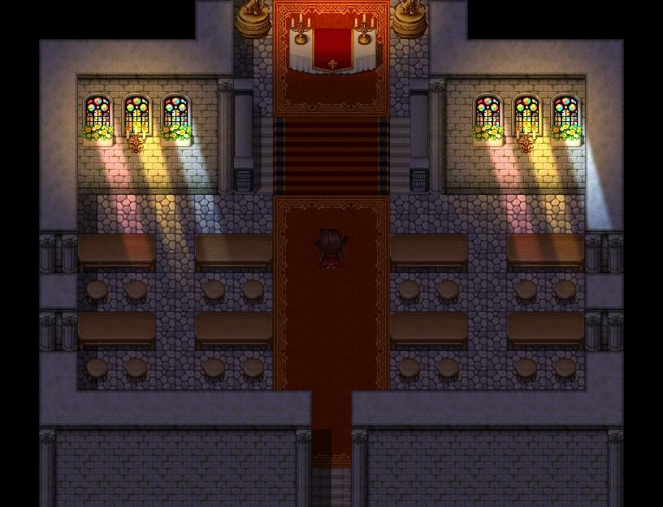
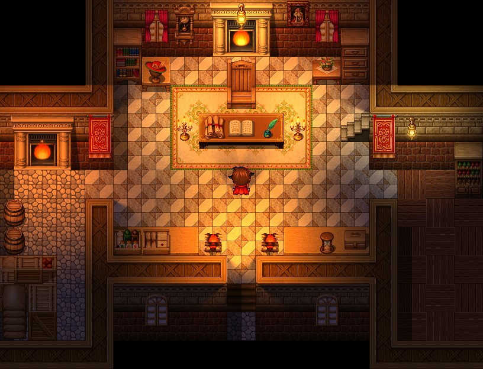
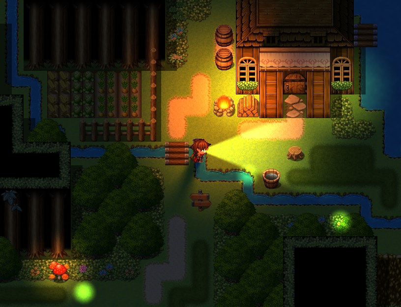
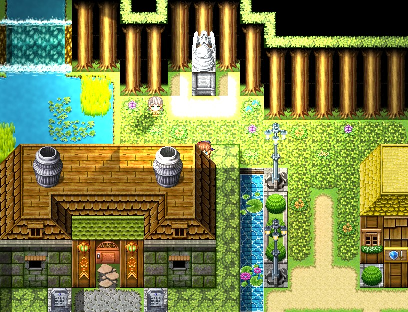

# GH_Lighting

Dynamic 2D lighting for RPG Maker MZ: day and night, torches and lanterns,
flashlights and sunbeams, flickering fire, soft shadows from walls and
characters, and normal maps. Everything is set up with notes, comments and
plugin commands; no scripting needed.

| | |
|---|---|
|  |  |
|  |  |

**[Download GH_Lighting.js](https://github.com/goathollow/rpg-maker-lighting/releases/latest/download/GH_Lighting.js)**
· [All releases](https://github.com/goathollow/rpg-maker-lighting/releases)
· [Changelog](CHANGELOG.md)

## Features

- **Day and night.** One global light for the whole game, faded by plugin
  command and kept in saves. Interiors and caves keep their own light with
  `<ambient>`.
- **Lights** on events and the player: torches, lanterns, candles,
  fireplaces, crystals, magic, in any color. Lights fade out by day and
  come back at dusk on their own.
- **Flashlights and sunbeams.** Cones that turn with the character, and
  beams of light through windows.
- **Flicker** that looks like fire, not a blinking bulb, with Fire, Candle,
  Pulse and Faulty styles.
- **Soft shadows**, with no setup: walls and roofs block light, and
  characters cast shadows in the shape of their sprites. Higher lights cast
  shorter shadows.
- **Normal and ambient occlusion maps** for characters, tilesets and
  parallaxes, found by file name, so light catches the shapes in your art.
- **Desktop, browsers and phones:** WebGL 1 and 2, with a quality setting
  for slower devices.

## Install

1. [Download `GH_Lighting.js`](https://github.com/goathollow/rpg-maker-lighting/releases/latest/download/GH_Lighting.js).
2. Put it in your project's `js/plugins/` folder. Keep the file name: RPG
   Maker finds the plugin's parameters and commands by it.
3. In the editor, open **Tools > Plugin Manager**, add **GH_Lighting** and
   turn it on.

The plugin's help, shown in the Plugin Manager, is the full guide. Needs
RPG Maker MZ (tested with 1.10.0); it does not work in MV.

## Quick start

1. Make a map dark. In its Note box (Map Properties), write:

   ```
   <ambient: Night>
   ```

2. Give an event a light. In the event's Note box, write:

   ```
   <light: Torch>
   ```

Play-test, and the torch lights up the area around it.

## Quick reference

**Map notes**

| Note | Effect |
|---|---|
| `<ambient: Night>` | The map's own light level: Day, Evening, Night, Dungeon, Cave, Darkness |
| `<ambient: #303860>` | ...or any color (also `48,56,96`) |
| `<ambient: off>` | Always fully lit, whatever the global light |
| `<shadows: off>` | No shadows on this map |

Maps without `<ambient>` follow the global light (the Global Light
parameter, then the Set Global Light command).

**Event notes, or comments on an event page** (a page's comment wins, so
page conditions can switch lights on and off)

| Note | Effect |
|---|---|
| `<light: Torch>` | A preset: Torch, Candle, Lamp, Fireplace, Lantern, Crystal, Magic, Flashlight, Sunbeam |
| `<light: Torch radius: 240>` | A preset with changes |
| `<light: color: #80ff80 radius: 100>` | No preset, settings given |
| `<light: Flashlight spread: 90>` | A wider cone, pointing the way the event faces |
| `<light: Sunbeam direction: 45 width: 32 radius: 300>` | A beam at 45 degrees |
| `<light: Lamp flicker: Faulty>` | A lamp on the fritz |
| `<light: off>` | No light (on this page) |
| `<shadow: off>` | This event casts no shadow |

Light settings: `color`, `radius`, `intensity`, `flicker`, `shape` (point,
cone, beam), `direction`, `spread`, `width`, `shadows`, `softness`,
`height`, `x`, `y`. The help explains each one.

**Plugin commands:** Set Global Light, Set Map Ambient, Reset Map Ambient,
Set Event Light, Set Player Light. Fades take a duration and can wait to
finish.

Presets are plugin parameters: edit them, or add your own, and every tag
that names them follows.

## Normal and AO maps

Save maps beside an image, with the same name plus an ending:

```
img/characters/Actor1.png          the image
img/characters/Actor1_normal.png   its normal map (or _n)
img/characters/Actor1_ao.png       its ambient occlusion map (or _o)
```

They are found by name in `img/characters`, `img/tilesets` and
`img/parallaxes`; there is nothing to set up. Normal maps should be "green
up" (OpenGL style), which most tools make; if light seems to come from
below, set **Normal Map Green** to "down". Images without maps can get a
rough one from their light and dark pixels with **Auto Normal Maps**.

To make normal and AO maps for your sprites and tiles, try
[Totally Normal Mapper](https://store.steampowered.com/app/5251690/Totally_Normal_Mapper?utm_source=github&utm_campaign=gh_lighting),
our normal mapping tool on Steam. Maps from any other tool work too.

## Deploying

- After adding or removing normal or AO maps, **play-test once before
  deploying**. The play-test saves the list of maps to
  `data/GH_LightingMaps.json`, which browsers and phones need, since they
  can't look inside folders.
- When deploying, leave **Exclude unused files** unchecked, or the maps are
  left out: nothing in the database names them.
- Encrypted images are fine.

## Performance

- **Light Quality** (parameter) sets the light buffer's resolution. Half is
  the default; Quarter is faster on phones and older PCs.
- Shadows are the slowest part on phones. Turn them off on busy maps with
  `<shadows: off>`, or everywhere with the Shadows parameter.
- Lights that add nothing (most lights by day) cost nothing.

## Compatibility

- GH_Lighting only adds to MZ's own code, never replaces it, so it works
  alongside most plugins. If there's no lighting at all and no error in the
  console, another plugin may build the map's sprites its own way: place
  GH_Lighting below it in the Plugin Manager.
- Lighting covers the map: tiles, the parallax and characters. Weather,
  pictures, the timer, windows and battles are drawn as usual.
- You can add it to a game in progress: saves made before it load fine,
  and so do saves made with it if you remove it again.
- Don't use it together with another lighting plugin.

## Limitations

- Specular and metallic maps aren't supported yet (`_specular` images are
  ignored).
- Each light is shadowed by the nearest 8 characters at most.
- Battles aren't lit.

## Troubleshooting

Press **F8** during a play-test to open the console. Typos such as an
unknown preset name or an unreadable color are reported there, with the
map and event they came from. The plugin's help has more.

Found a bug? [Open an issue](https://github.com/goathollow/rpg-maker-lighting/issues)
with your MZ version, the plugin version and anything the console shows.

## Contributing

See [CONTRIBUTING.md](CONTRIBUTING.md) to build and test the plugin, and
[docs/how-it-works.md](docs/how-it-works.md) for how it works inside.

## License

[MIT](LICENSE): free to use in commercial and non-commercial games, and to
change and share, as long as the license notice in the plugin file stays
with it. Credit to Goat Hollow Games is appreciated, not required.
